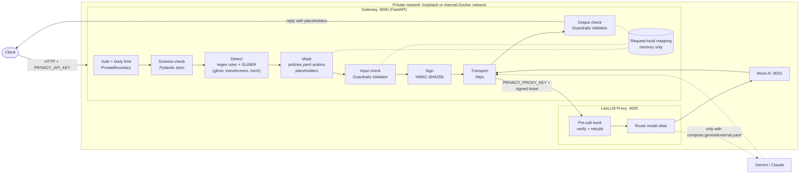

# Local LLM Data Privacy Gateway

A standalone FastAPI prototype that extracts documents locally, detects confidential entities
with GLiNER plus rules, applies YAML policies, validates through custom Guardrails AI validators,
and sends only approved text through a private LiteLLM Proxy. The default provider is a local
echo mock. No paid detection services, Presidio, or external LLM credentials are needed.

**Prototype, not a guarantee of anonymization.** Detection can miss information and can overmask.
See [security assumptions](docs/security.md), [evaluation](docs/evaluation.md), and
[compatibility and licenses](docs/decisions.md).

## Architecture

The system is three local processes. Only the LiteLLM Proxy can ever talk to an AI provider, and
it forwards only requests that the gateway has masked, validated, and signed.

| Process | Port | Code | Built on | Job |
|---|---|---|---|---|
| Gateway | 8000 | `privacy_gateway/api.py` and modules below | FastAPI 0.143.1 on Uvicorn | Public API: extraction, detection, masking, validation, signing |
| LiteLLM Proxy | 4000 | `config/litellm*.yaml`, `privacy_gateway/proxy_hook.py` | LiteLLM Proxy 1.105.1 | Verifies the signature, rebuilds the request, makes the one provider call |
| Mock AI | 8001 | `privacy_gateway/mock_llm.py` | FastAPI | Default provider: OpenAI-compatible endpoint that echoes the masked messages |
| AI provider (optional, off) | — | `compose.gemini.yaml`, `compose.external.yaml` | Gemini or Claude via LiteLLM | Reached only by the proxy, only when explicitly enabled |



### One `/llm/chat` request, step by step

| # | Step | What happens | Code | Technology |
|---|---|---|---|---|
| 1 | Authenticate | Constant-time check of `Authorization: Bearer PRIVACY_API_KEY`; body capped at 6 MB; JSON with duplicate keys or `NaN` rejected, before FastAPI parses anything | `api.py` `PrivateBoundary` | ASGI middleware, `hmac`, `json` |
| 2 | Validate schema | Only `category`, `messages` (≤32, each ≤32,000 chars, plain `role`/`content`), and `max_tokens` (≤2048). Unknown fields, tools, URLs, model names, and streaming are refused | `schemas.py` | Pydantic 2.14.1, `extra="forbid"`, strict |
| 3 | Pre-check | Total size limit, control-character check, and refusal of any input already containing placeholder syntax such as `[PERSON_001]` | `pipeline.py`, `documents.py` `check_text` | Python `re` |
| 4 | Detect | Regex patterns, labeled fields, birth dates, and custom terms always run. GLiNER runs on CPU in ≤600-character / ≤200-token overlapping chunks, threshold 0.35. Results are cleaned up and de-duplicated | `detection.py` | Python `re`; `gliner` 0.2.29 with `urchade/gliner_small-v2.1` (pinned revision), `transformers` 5.16.1, `torch` 2.14.1, offline mode forced |
| 5 | Find repeats | Every other occurrence of a found value is flagged in all messages | `masking.py` `propagate` | Python `re` |
| 6 | Apply policy | Overlapping spans are merged. The strictest action wins: `block` refuses the request, `mask` gives `[TYPE_NNN]`, `generalize` gives a fixed label | `policy.py`, `masking.py` `mask` | `config/policies.yaml` read with PyYAML, checked with Pydantic |
| 7 | Validate input | Fails if an original value remains, a placeholder was not created by this request, or re-detection finds a sensitive entity | `validators.py` `InputPrivacyValidator`, `pipeline.py` `validate` | Guardrails AI 0.11.0 `Validator` subclass, called directly (no `Guard`, no Hub, no telemetry) |
| 8 | Sign | HMAC-SHA256 over the exact `model`, `messages`, `max_tokens`, `stream=false`, plus a timestamp and a random one-time value | `approval.py` `sign` | `hmac`, `hashlib`, `secrets` |
| 9 | Send to proxy | POST to `/v1/chat/completions` with `PRIVACY_PROXY_KEY`. Destination must be a local address; environment proxies and redirects are ignored | `transport.py` `ProxyTransport` | httpx 0.28 |
| 10 | Verify at proxy | Before routing: rejects streaming, tools, `api_base`/`api_key`/`extra_body`, other models, non-text messages; checks the signature, ≤30-second age, and one-time value. Then clears the request and rebuilds it from the signed fields only | `proxy_hook.py` `ApprovalHook.async_pre_call_hook` | LiteLLM `CustomLogger` pre-call hook (never the concurrent moderation hook) |
| 11 | Call provider | The proxy maps the alias (`privacy-mock`, `privacy-gemini`, `privacy-claude`) to the provider. Logging, caching, and spend tracking are off | `config/litellm.yaml` and example files | LiteLLM routing |
| 12 | Buffer reply | Whole reply read with a size cap; must be exactly one plain-text answer with no tool calls | `transport.py` | httpx |
| 13 | Validate output | Same checks as step 7 on the AI reply, before you see anything | `validators.py` `OutputPrivacyValidator` | Guardrails AI `Validator` |
| 14 | Respond | Reply returned with placeholders; real values are never restored. The request-local mapping is cleared | `api.py` `chat` | FastAPI |

Any failure stops the request and returns a fixed error code. Request bodies and exceptions are
never logged (Uvicorn runs with `--no-access-log`; errors are caught before they reach a log).

The other endpoints use parts of this path. `/detect/text` stops after step 4 and returns only
offsets and types. `/mask/text` and `/mask/document` stop after step 7 and return the masked text
as a local preview. `/preview/text` and `/preview/document` add the side-by-side review described in
[Review before sending](#review-before-sending), and `/llm/document` sends a reviewed file. File
endpoints read images and image regions with local Tesseract OCR as well as: PDF with PyMuPDF 1.28.2, DOCX with
python-docx 1.2.0 and lxml, plus TXT and JSON. `/llm/chat` takes text messages only.

### Secrets

`scripts/init_env.py` creates three separate secrets in `.env`. Provider keys live only in the
proxy's own key file.

| Secret | Held by | Protects |
|---|---|---|
| `PRIVACY_API_KEY` | Client, gateway | Client → gateway |
| `PRIVACY_PROXY_KEY` | Gateway, proxy | Gateway → proxy (LiteLLM `master_key`) |
| `PRIVACY_SIGNING_KEY` | Gateway (signs), proxy (verifies) | Proof that text passed steps 3–7; a stolen proxy key alone cannot send unmasked text |
| Gemini / Anthropic key | Proxy only (`.env.gemini`, `.env.anthropic`) | Proxy → provider |

### Deployment

- **Local:** `scripts/run_local.py` starts the mock, proxy, and gateway on `127.0.0.1`.
- **Docker** (`compose.yaml`): the same three services on an `internal: true` network with no
  internet route. Only gateway port 8000 is published, on loopback. Containers drop all Linux
  capabilities; the gateway and mock are read-only and the model directory is mounted read-only.
- **External provider:** `compose.gemini.yaml` or `compose.external.yaml` gives only the proxy an
  internet route and a provider key. The gateway also needs `PRIVACY_EXTERNAL_ENABLED=true` and
  GLiNER mode; otherwise it refuses to start a non-mock route.

### Example

Synthetic agreement (category `agreements`):

| Step | Text |
|---|---|
| You send | `This agreement is between Brambleton Ltd (the supplier) and Corvane Retail (the buyer). Buyer contact name: Owen Pratley` |
| AI receives | `This agreement is between [ORGANIZATION_001] (the supplier) and [ORGANIZATION_002] (the buyer). Buyer contact name: [PERSON_001]` |
| Kept locally, then deleted | `[ORGANIZATION_001]` = Brambleton Ltd, `[ORGANIZATION_002]` = Corvane Retail, `[PERSON_001]` = Owen Pratley |

The same value always gets the same placeholder within a request, so the AI can still tell the
parties apart. Replies keep the placeholders; real names are not restored.

| Result | Meaning |
|---|---|
| `200` | Masked text was sent; the reply passed its check |
| `401 unauthorized` | Missing or wrong `PRIVACY_API_KEY` |
| `413` / `415` | Request, text, or document too large; unsupported file type |
| `422 policy_blocked` | A blocked type (for example confidential commercial terms) was found; nothing sent |
| `422 input_validation_failed` | The input check could not confirm the masking; nothing sent |
| `422 output_validation_failed` | The AI reply contained a sensitive value; reply withheld |
| `422 invalid_request` | Empty or malformed request; nothing sent |
| `502 upstream_unavailable` | Proxy or provider failed, or the reply was malformed or too large |
| `503` | Model, validator, or proxy configuration unavailable; nothing sent |

See [architecture](docs/architecture.md) for design rationale and security notes.

## Detection and masking methods

Step 4 combines several local detectors. Their findings are merged before masking.

| Method | What it finds | Example |
|---|---|---|
| Pattern rules | Values with a fixed shape: email, phone (9+ digits), MRN, SSN/Aadhaar, IBAN, PAN/GSTIN, money amounts, `sk-`/`AKIA` API keys | `MRN-45821`, `USD 420.00` |
| Labeled fields | Any value after a known label, up to the end of the line or the next column (a tab, three or more spaces, or a table cell border); in tables, values under a label column header or beside a label cell | `Customer name: Mira Vale`, `\| Phone \| 98765 43210 \|` |
| Dates of birth | A date after a birth label, with or without a colon | `Date of birth 14 Apr 1993` |
| Custom terms | Literal phrases from `custom_terms` in `config/policies.yaml` (never regex) | `Project Cedar` |
| GLiNER model | Unlabeled names, organizations, addresses, diagnoses, commercial terms, internal information | `…between Brambleton Ltd and…` |
| Repeats | Every other occurrence of an already-found value, in all messages (case-insensitive) | a name mentioned again later |

Clean-up rules drop model hits that are only generic words (`her`, `All staff`) or field labels,
extend an address to its city and postcode, and ignore phone/bank matches inside document numbers
such as `INV-2026-00417`. Overlapping detections are merged and replaced as one span.

Step 6 applies the category policy to each detected type:

| Action | Effect | Example |
|---|---|---|
| `mask` | Numbered placeholder, the same for every repeat in the request | `Owen Pratley` → `[PERSON_001]` |
| `generalize` | Fixed category label | diagnosis → `[HEALTH_CONDITION]` (healthcare only) |
| `block` | The whole request is refused; nothing is sent | API key, commercial term |
| `allow` | Left unchanged | not used by default |

Steps 7 and 13 refuse the text if an original value is still present, a placeholder was not
created by this request, or re-detection finds a sensitive entity outside the placeholders.
Detection decides everything: a value that no detector recognizes and that has no label is not
masked.

## What data it works on

English text in raw text or JSON, TXT, DOCX, PDF (searchable, scanned, or mixed), and PNG/JPEG/WEBP
images such as ID cards (Aadhaar, PAN, voter ID, driving licence, passport), up to 32,000 characters
and 5 MB. Images and image regions in PDFs are read with local Tesseract OCR (English + Hindi).
OCR words below confidence 60, and any non-Latin word (for example the Hindi lines on an Aadhaar
card), are always masked as `UNVERIFIED_TEXT`, because the detectors cannot check them. Handwriting
and other languages are not supported. Format details are under [API](#api).

| Category | Default policy beyond masking | Expect |
|---|---|---|
| `general` | Commercial terms, internal information, and secrets are blocked (all categories) | Masks personal and financial identifiers |
| `healthcare` | Diagnoses are generalized, not masked | Clinical meaning is reduced |
| `invoices` | Amounts are masked | Totals and line amounts become placeholders |
| `agreements` | Any detected commercial term blocks the request | Frequent refusals on real contracts |
| `guidelines` | Any detected internal information blocks the request | Frequent refusals on real internal policies |

**Agreements:** party names, signatories, addresses, contact details, amounts, and bank/tax IDs are
masked. With GLiNER, pricing, payment, liability, discount, and termination clauses can be detected
as confidential commercial terms, and one detection refuses the whole document. Rules mode catches
commercial terms only under labels such as `Commercial terms:`, so unlabeled clauses pass through.
Signature images in PDFs are read by OCR; an unreadable signature becomes `UNVERIFIED_TEXT`.
Long contracts over the size limit are rejected.

**Guidelines:** names, contacts, and project names are masked. Internal policies and procedures are
organizational content, so GLiNER detections of internal information refuse the document; one
synthetic test guideline was refused because `MFA` was scored as internal information.

These blocks are server policy in `config/policies.yaml`. Changing them to `mask` lets such
documents through with the detected spans replaced, but sends the remaining clause text to the
provider. Treat that as an organizational decision. The measured results are on small synthetic
English sets; see [evaluation](docs/evaluation.md).

## Install

Use Python 3.11–3.13; Python 3.14 is excluded by Guardrails AI 0.11.0. Python 3.13 was used here.

```sh
python -m venv .venv
# Linux/macOS: source .venv/bin/activate
# PowerShell: .\.venv\Scripts\Activate.ps1
python -m pip install -e '.[dev,proxy]'
python scripts/init_env.py
python scripts/download_model.py
python scripts/run_local.py
```

Model provisioning downloads pinned public weights and tokenizer artifacts once. It does not
upload text. Runtime inference uses only local files. Allow roughly 2 GB for the environment
and at least 1 GB for weights/cache, plus model working memory. The CPU model may be slow.
Missing weights prevent default startup; there is no silent rules-only fallback.

`init_env.py` creates three independent secrets in `.env`. It refuses to overwrite an existing file.
Keep `.env` private. The launcher starts mock (8001), proxy (4000), and gateway (8000) on loopback.
Ctrl+C stops them. Check `http://127.0.0.1:8000/health` for local readiness; this endpoint does not
promise the proxy/provider is healthy.

For a fast synthetic demonstration, explicitly set `PRIVACY_DETECTOR=rules` in `.env` and skip
model provisioning. Rules mode is limited to the local mock; it misses unlabeled names/addresses.

## Docker

On Windows systems that block native PyTorch or PyMuPDF libraries, use Linux containers.

```sh
docker build -t local-privacy-gateway:dev .
# Create .env once using any installed Python:
python scripts/init_env.py
# Provision into a workspace-mounted directory; this one-time command needs internet access:
docker run --rm --mount "type=bind,source=YOUR_ABSOLUTE_WORKSPACE,target=/app" local-privacy-gateway:dev python scripts/download_model.py
docker compose up --build
```

Replace YOUR_ABSOLUTE_WORKSPACE with this project's absolute path. In PowerShell use
`"type=bind,source=$PWD,target=/app"`. The default Compose network is internal (no provider
internet egress), and only gateway port 8000 is published to loopback. Models are mounted read-only
in the running gateway. Stop with `docker compose down`.

## API

Every endpoint except `/health` requires `Authorization: Bearer <PRIVACY_API_KEY>`.
Automatic request schemas reject unknown fields. Errors are fixed codes without input echoes.
All responses disable HTTP caching. There is no reidentification endpoint or returned mapping.

| Endpoint | Input | Result |
|---|---|---|
| POST /detect/text | `{ "text": "...", "category": "general" }` | Offsets, types, confidence, sources; no original entity values |
| POST /mask/text | `text` or structured `data`, plus category | Sanitized text, span count, detector mode |
| POST /mask/document | Multipart `file`, `category` | Sanitized extracted text |
| POST /llm/chat | `messages`, `category`, optional `max_tokens` | Validated, still-pseudonymized assistant message |
| GET /health | None | Local readiness and detector mode |

Categories: `healthcare`, `invoices`, `agreements`, `guidelines`, `general`.
Policies are server-managed in `config/policies.yaml`; they support allow, mask, generalize,
and block. Unconfigured entity types and invalid policies fail closed.

Example synthetic input:

```json
{
  "category": "healthcare",
  "text": "Patient: John Smith\nPatient ID: MRN-45821\nPhone: 9876543210\nDiagnosis: Diabetes"
}
```

Rules-mode result (GLiNER may identify additional entities):

```text
Patient: [PERSON_001]
Patient ID: [MRN_001]
Phone: [PHONE_001]
Diagnosis: [HEALTH_CONDITION]
```

The supplied healthcare policy generalizes diagnoses. An administrator can explicitly allow
them after reviewing the use case; they are not assumed safe by default.

PowerShell example, loading the key without placing it in shell history:

```powershell
$apiLine = Get-Content .env | Where-Object { $_ -like 'PRIVACY_API_KEY=*' }
$headers = @{ Authorization = 'Bearer ' + $apiLine.Split('=', 2)[1] }
$body = @{ category = 'healthcare'; messages = @(
  @{ role = 'user'; content = "Patient: John Smith`nPatient ID: MRN-45821`nPhone: 9876543210" }
) } | ConvertTo-Json -Depth 5
Invoke-RestMethod http://127.0.0.1:8000/llm/chat -Method Post -Headers $headers -ContentType application/json -Body $body
```

Other request examples:

```sh
curl http://127.0.0.1:8000/mask/text -H "Authorization: Bearer $PRIVACY_API_KEY" -H "Content-Type: application/json" -d '{"category":"invoices","data":{"customer_name":"Mira Vale","account":"123456789012","amount":"USD 420.00"}}'
curl http://127.0.0.1:8000/mask/document -H "Authorization: Bearer $PRIVACY_API_KEY" -F "category=healthcare" -F "file=@synthetic.docx"
```

TXT must be valid UTF-8. JSON is flattened into text while retaining keys, paths, and scalar values;
the service does not promise the original JSON shape. PDF text layers are read directly and every
image region (including inline images) is rendered at up to 300 dpi and read with OCR; text already
in the text layer is not duplicated. Blank pages, annotations, forms, attachments, and repaired files
are rejected, and image-bearing pages are rejected when OCR is unavailable. Link annotations are
allowed. The one tolerated attachment is a C2PA provenance manifest ("Content Credentials"), which
is never read or forwarded.
DOCX paragraphs, tables, headers/footers, comments, footnotes, and endnotes are read locally;
images, embedded files, fields, tracked changes, drawings, and equations are rejected.

Before masking, the layout is written into the text (`privacy_gateway/layout.py`), so the AI
receives structure and not only words:

| Structure | PDF | DOCX |
|---|---|---|
| Reading order | Bands separated by wide gaps, then two text columns read one after the other; short side-by-side text (labels and values, invoice headers) stays on one row | Document order |
| Headings | Short single-line text in a larger font (`#`, `##`) or all bold (`###`) | Heading and Title styles, outline levels |
| Tables | Bordered tables found by PyMuPDF as `\| cell \| cell \|` rows | Every table, with merged columns kept aligned; nested tables are flattened into their cell |
| Lists | Not detected | List numbers and bullets (`1.`, `a.`, `-`) |
| Pages | `--- page N ---` between pages; margin text repeated on two or more pages labelled `Page header:` / `Page footer:` | Header and footer parts labelled the same way; footnotes, endnotes, and comments in labelled sections, with `[^1]` markers |
| Line breaks, tabs | Wide gaps between pieces of one row written as three or more spaces | Kept |

This markup is not printed in the document, so it never becomes a masked value. Layout detection
is heuristic: three or more columns, text wrapped around figures, borderless tables, and equations
can still come out in a wrong order or as plain lines.
Document binaries are never forwarded. Masking endpoints are local previews; `/llm/chat` takes
original text/history and performs its own enforcement. Reserved placeholder syntax in new input
is rejected, so do not feed preview output back into chat.

## Review before sending

With Docker, start the stack with the UI override so the page is reachable on loopback:

```
docker compose -f compose.yaml -f compose.ui.yaml up -d --build
```

Then open `http://127.0.0.1:8010/review` in a browser on the gateway host (`run_local.py` serves
it at `http://127.0.0.1:8000/review`). `compose.ui.yaml` adds `ui-relay`, a stdlib byte relay
(`scripts/ui_relay.py`) on both the internal network and an ingress network, because Docker
publishes no ports for internal-only containers. The gateway stays without an internet route; the
relay has egress but parses, stores, and logs nothing.

To let another device on the same network use this gateway, add the opt-in HTTPS relay
(`compose.lan.yaml`). It binds to the Wi-Fi address only, never `0.0.0.0`, and terminates TLS
(1.2+, self-signed) so documents, original values, and the API key are encrypted on the network.
In PowerShell, with the stack built:

```
$env:LAN_IP = "192.168.1.9"   # this laptop's Wi-Fi IPv4 address (ipconfig)
docker compose -f compose.yaml run --rm --no-deps -v "${PWD}\.runtime\lan-tls:/out" gateway python scripts/make_lan_cert.py --ip $env:LAN_IP --out /out
docker compose -f compose.yaml -f compose.ui.yaml -f compose.lan.yaml up -d
```

The other device opens `https://<LAN_IP>:8443/review`, compares the certificate's SHA-256
fingerprint with the one `make_lan_cert.py` printed, accepts the warning, and enters the API key.
Anyone with the key has full access and sees the originals they upload; there are no per-user
accounts or rate limits. If the Wi-Fi address changes, delete `.runtime/lan-tls` and repeat both
steps. Stop LAN access with `docker compose -f compose.yaml -f compose.ui.yaml -f compose.lan.yaml
stop lan-relay`, and on untrusted networks do not start it.

The page is static: it asks for `PRIVACY_API_KEY` (kept only in that tab) and calls only the
`/preview/*` endpoints, which never reach the transport. It takes a dropped or chosen file (PDF,
image, DOCX, TXT, JSON) or pasted text; a paste that parses as a JSON object or array is sent as
structured `data`. It has no category picker: it always uses the server default `general`, which
masks every detected type (use the API to choose another category). It shows:

- the original document next to a **masked copy of the same document** (PDF or PNG with every
  masked word blacked out and labeled with its placeholder);
- the extracted text next to the masked text the AI would receive, with paired highlights;
- every replacement: type, action, original value, placeholder, detectors, confidence;
- OCR statistics, blocked types, and any masked value it could not cover on the page (no printed
  position, or still readable when the PDF copy is read back after redaction).

The masked copy is a review aid. It does not remove photos, QR codes (an Aadhaar QR code holds the
card details), signatures, or other graphics, so do not share it as a redacted ID. It is never sent
anywhere; only masked text is sent.

By default the page is mask-only: copy the masked text or download the masked copy. The AI test
section appears only at `/review?send=1`. There, "Send reviewed masked text" posts the original input again with the preview's `preview_sha256`.
The gateway repeats extraction and masking and refuses with `409 preview_mismatch` unless the first
message masks to exactly the reviewed text, so the AI receives what you approved. With a blocked
type the preview still shows the values (`sendable: false`) but nothing can be sent.

```sh
curl http://127.0.0.1:8000/preview/document -H "Authorization: Bearer $PRIVACY_API_KEY" -F "category=general" -F "file=@synthetic-card.jpg"
curl http://127.0.0.1:8000/llm/document -H "Authorization: Bearer $PRIVACY_API_KEY" -F "file=@synthetic-card.jpg" -F "question=What kind of document is this?" -F "approved_preview_sha256=<from preview>"
```

| Endpoint | Input | Returns |
|---|---|---|
| `POST /preview/text` | JSON `{category, text}` or `{category, data}` | `original_text`, `sanitized_text`, `spans`, `summary`, `sendable`, `preview_sha256` |
| `POST /preview/document` | multipart `file`, `category` | The same, plus `ocr` and `masked_document` (`media_type`, `base64`, `note`, `unlocated_spans`) |
| `POST /llm/chat` | adds optional `approved_preview_sha256` | adds `sent_messages`, the exact masked messages sent |
| `POST /llm/document` | multipart `file`, `category`, optional `question`, `max_tokens`, `approved_preview_sha256` | as `/llm/chat` |

Every `/mask/*`, `/preview/*` and `/llm/*` endpoint also takes an optional `mask`: the entity types
to mask, as a JSON list (`"mask": ["PERSON", "PHONE"]`) or a comma-separated form field
(`-F "mask=PERSON,PHONE"`). Only those types are masked; everything else is kept. Blocked types
(secrets, commercial terms, internal information) are still refused and unreadable OCR text is still
masked. Responses echo the selection in `mask` (`null` when the server policy was used). Types:
`PERSON EMAIL PHONE ADDRESS MRN DATE_OF_BIRTH GOVERNMENT_ID BANK_ACCOUNT TAX_ID ORGANIZATION PROJECT
DIAGNOSIS AMOUNT COMMERCIAL_TERM INTERNAL_INFORMATION SECRET UNVERIFIED_TEXT`.

The preview returns original values next to their placeholders to the caller who sent them. That is
inside the single API-key trust domain, but treat preview responses as confidential.

## Test and evaluate

```sh
python -m pytest -q
# POSIX:
RUN_PROXY_TESTS=1 RUN_MODEL_TESTS=1 python -m pytest -q
# PowerShell equivalents: $env:RUN_PROXY_TESTS='1'; $env:RUN_MODEL_TESTS='1'
python scripts/evaluate.py --mode rules
python scripts/evaluate.py --mode gliner --output docs/evaluation-gliner.json
# Per input type (text, PDF, scanned PDF, image, phone photo), inside the Docker image:
PYTHONPATH=.:scripts python scripts/evaluate_documents.py --mode gliner --output docs/evaluation-documents-gliner.json
python -m ruff check privacy_gateway scripts tests
```

For Linux verification in Docker, mount this workspace and pass `-e RUN_PROXY_TESTS=1`
and `-e RUN_MODEL_TESTS=1` to `docker run`, then execute `python -m pytest -q`.
The live proxy test uses synthetic capture files in a temporary directory and starts/stops its
own loopback servers. See docs/evaluation.md for measured results and limitations.

## Layout and extension points

- `privacy_gateway/`: API/authentication, local extraction, detection, masking, policy engine,
  Guardrails validators, approval signing, private proxy transport and mandatory callback, local mock.
- `config/`: category policies, default local proxy configuration, disabled external-provider example.
- `scripts/`: local setup/startup, pinned model provisioning, synthetic evaluation.
- `tests/`: unit, format, failure, bypass, actual proxy, and actual model tests.
- `Dockerfile`, `compose.yaml`: optional isolated local deployment.
- `docs/`: architecture, security, decisions, and evaluation; `AGENTS.md`: maintenance instructions.

Optional Claude routing is documented in `config/litellm.external.example.yaml`. It requires
an explicit model/provider configuration, credentials, full GLiNER mode, external opt-in, and
operator-controlled proxy egress. The current Compose network intentionally has no internet route.
Opt-in Compose add-ons give only the proxy an egress network and a provider key file the gateway
never reads: `compose.gemini.yaml` (Google AI Studio key in `.env.gemini`; free-tier usage may be
used by Google to improve its products) and `compose.external.yaml` (Anthropic key in
`.env.anthropic`). Use synthetic data only; `docker compose up -d` returns to the offline mock.
The public API never accepts a provider URL or model selector.

Next priorities: larger independently labeled evaluations, tenant-bound policies/authentication,
better document completeness checks and OCR, semantic business-secret detection, independent
secondary validation, and operational limits/security review before any production use.

