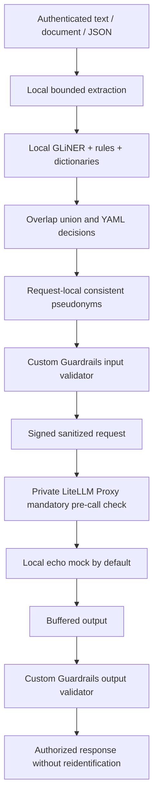

# Architecture

The API is the sole entry point. A bounded ASGI authentication/body boundary runs before parsing;
strict Pydantic models eliminate caller-provided tools, metadata, URLs, streaming, and provider options.
Local extraction never uploads binary documents. Detection returns offsets instead of entity values.
All overlapping spans are grouped, the strictest action wins, and the entire union is protected.
A low-confidence blocked span cannot be overridden by a higher-confidence allowed span.

Masking propagates literal detected values across all messages in a request, preserving repeated
references. Counters and mappings exist only in local memory and are cleared in finally blocks.
There is no persistent vault, mapping response, restoration, conversation database, or shared history.
Python cannot guarantee physical zeroization of immutable strings; host memory is trusted.

Input and output validators subclass the installed Guardrails AI Validator, implement `_validate`,
and run through its public `validate` API. They reuse local detection/policies, look for original
protected values, and recognize only placeholders created within this request. Errors return failure.
No Guard object, remote Hub validator, reask, or Guard history is used. Telemetry and tracing are
disabled programmatically rather than relying on a user's global Guardrails configuration.

`transport.py` is the only component allowed to send a chat request. Every message has completed
masking and input validation before transport executes. It signs a fixed canonical envelope with an
independent HMAC key, timestamp, and nonce. The open-source LiteLLM CustomLogger pre-call callback
verifies the envelope synchronously before routing, rejects known unsupported fields, and rebuilds
outbound arguments from a fixed allowlist. Unsigned metadata, headers, and unknown provider fields
are discarded, including the approval proof. A request-body logging snapshot is not required.
It never uses async_moderation_hook. A bounded replay cache is process-local, so deploy one proxy
worker until a shared replay store is added. Network isolation remains essential.

The transport disables environment proxy inheritance and redirects, pins its destination to a local
proxy address, bounds response bytes, and discards provider metadata/errors. Output validation
finishes before a single response is returned. Streaming and tool calls are deliberately unsupported.

External integrations are configuration-only opt-ins. There are no provider credentials in the
gateway; only the proxy receives them. Use separate deployment egress policies: the gateway should
reach only the proxy, the proxy should reach only approved providers, and clients cannot reach it.

